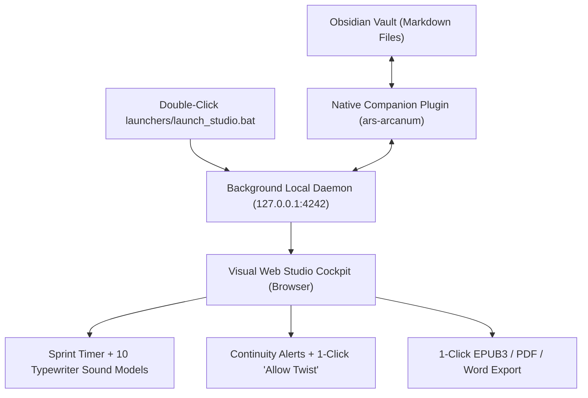
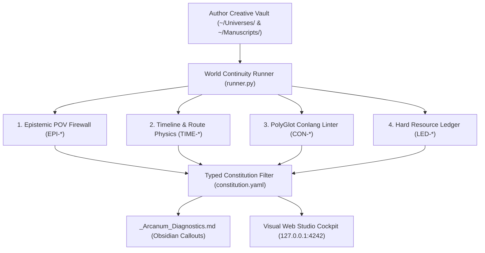

# 📖 Ars Arcanum Complete Author & Worldbuilder Manual
`docs/AUTHOR_MANUAL.md`

> **Sovereign Craft Studio & Authoring Operating System** | **Release:** `v0.1.0` | **Architecture:** 100% Offline Standard Library

---

## 1. The Sovereign Authoring Philosophy

Ars Arcanum treats speculative fiction (Science Fiction & Fantasy) novels, series, and worldbuilding bibles not as static text documents, but as an executable, verifiable repository. The system is founded on five core commitments:

1. **Absolute Creative Sovereignty**: Your words belong to you. Vaults (`~/Universes/` and `~/Manuscripts/`) are standard folders of plain Markdown files (`.md`). No cloud transmission, no telemetry tracking, and zero proprietary lock-in.
2. **Descriptive Telemetry over Normative Dogma ([ADR-0001](adr/0001-demotion-of-normative-evaluators-and-three-subsystem-epistemic-safety.md))**: We never issue subjective literary grades or tell you how to write. Subsystem 1 enforces deterministic physical, chronological, and epistemic invariants, while Subsystem 2 reports objective word, churn, and dialogue telemetry.
3. **Deterministic Rails over Generative Hallucination**: Zero generative AI prose. You write every word. Ars Arcanum verifies timeline physics, POV spoiler leaks, resource conservation, and conlang syllable phonotactics with 100% mathematical reproducibility.
4. **Physical Inode Protection on Drafts**: Draft milestones are promoted via physical disk inode separation (`shutil.copy2`) with `0o444` read-only permissions on historical baselines, preventing external editors (Obsidian, VS Code) from accidentally corrupting past revisions.
5. **Zero-Pip Survivability**: Built entirely on the Python `>=3.10` standard library so your creative projects will compile and verify decades from now without dependency rot.

---

## 2. Daily Drafting: Zero-CLI & Visual Cockpit Workflows

Fiction writers who prefer a distraction-free graphical writing environment do not need to interact with the command line:



### 2.1 The Visual Studio Cockpit
1. **Windows Launch**: Double-click [`launchers/launch_studio.bat`](../launchers/launch_studio.bat) (or run `python scripts/arcanum studio --open`).
2. **Dashboard Overview**:
   - **Manuscript Catalog**: Browse your universe portfolios, inspect active drafts, chapter word counts, and dialogue density.
   - **Continuity & Twist Assistant**: Run full-vault invariant checks. If an intentional narrative twist triggers a rule violation, click **"Allow / Intended Twist"** to record an instant rule suppression (`!RULE_ID`) in `constitution.yaml`.
   - **Sprint Engine**: Configure target words and session duration. Enjoy focused drafting with 10 procedural mechanical typewriter acoustic models (synthesized via Web Audio API) and automatic phase-aware effort point logging.
   - **Publishing Center**: Export camera-ready Typst PDFs, native zero-pip EPUB3s, or standard manuscript Word documents in one click.

### 2.2 Obsidian Companion Plugin
Your creative vault in `templates/world-bible/` includes the pre-installed native **Ars Arcanum Companion Plugin** (`.obsidian/plugins/ars-arcanum/`):
- **Status Bar Health**: Shows real-time vault health (`Arcanum: Clean` vs `Arcanum: N Issues`).
- **Ribbon Shortcut**: Click the pen nib icon in the left ribbon to pop open the Visual Studio Cockpit.
- **Command Palette**: Run `Ars Arcanum: Check Continuity` or `Ars Arcanum: Start Writing Sprint` directly from your keyboard.
- **Live Diagnostics**: Synchronized automatically with `_Arcanum_Diagnostics.md` native Obsidian callouts (`[!success]`, `[!warning]`).

### 2.3 Atmospheric Themes & Typewriter Acoustics
Switch between 11 visual theme presets and 10 mechanical typewriter acoustic models via the Theme Studio:
- **Themes**: `Sovereign Dark`, `Classic Light`, `Amber CRT`, `Cyber Neon`, `Synthwave Outrun`, `Illuminated Codex`, `Grimdark Iron`, `Cyberpunk Terminal`, `Forest Hearth`, `Deep Cosmos`, `Abyssal Crypt`.
- **Acoustic Models**: Underwood Model 5, Remington Standard, Selectric II, Smith Corona, Cherry MX Blue, Thock Linear, Cyber Relay, Steampunk Escapement, Scribe Quill, Gothic Relic.

---

## 3. The Nine-Stage Authorial Lifecycle & Phase-Aware Effort Engine

To protect novelists from burnout and prevent premature editing during early drafting, Ars Arcanum introduces **Phase-Aware Effort Points** (`arcanum sprint-effort`):

$$\text{Effort Points} = W_{\text{draft}} \cdot \mu_{\text{draft}}(\mathcal{S}) + W_{\text{outline}} \cdot \mu_{\text{outline}}(\mathcal{S}) + W_{\text{lore}} \cdot \mu_{\text{lore}}(\mathcal{S}) + W_{\text{revised}} \cdot \mu_{\text{revised}}(\mathcal{S})$$

| Lifecycle Stage ($\mathcal{S}$) | Drafting ($\mu_{\text{draft}}$) | Outlining ($\mu_{\text{outline}}$) | Lore / World ($\mu_{\text{lore}}$) | Revision ($\mu_{\text{revised}}$) | Primary Objective & Behavioral Guardrails |
| :--- | :---: | :---: | :---: | :---: | :--- |
| **1. Concept** | `1.00x` | `1.00x` | `0.50x` | `0.00x` | Freeform premise exploration, high-concept pitching. |
| **2. Pre-Draft Outline** | `1.00x` | `1.00x` | `0.50x` | `0.00x` | Structural beat sheet, chapter milestone planning. |
| **3. Drafting** | `1.00x` | `0.50x` | `0.50x` | **`0.00x`** | **Forward momentum only**. Premature editing awards 0 points to prevent stalling on chapter 1. |
| **4. Pre-Revision Outline**| `1.00x` | `1.00x` | `0.50x` | `0.50x` | Post-first-draft diagnostic pass, structural surgery map. |
| **5. Revision** | `1.00x` | `0.50x` | `0.50x` | `0.20x` | Major structural rewrites, scene excision, character arcs. |
| **6. Beta Review** | `1.00x` | `0.50x` | `0.50x` | `0.20x` | Incorporating reader feedback and continuity fixes. |
| **7. Proofing** | `1.00x` | `0.20x` | `0.20x` | `0.20x` | Line editing, cadence polish, typography cleanup. |
| **8. Querying** | `1.00x` | `1.00x` | `0.20x` | `0.20x` | Synopses, query letters, sample chapter packets. |
| **9. Publishing** | `1.00x` | `0.20x` | `0.20x` | `0.20x` | Final preflight verification, camera-ready compilation. |

```bash
# Example: Log a 2,000-word drafting sprint with 400 words of lore notes
arcanum sprint-effort --workspace ~/Universes/Reliquary/ --book "Prisoner of Sand Sea" --stage Drafting --draft 2000 --worldbuilding 400
```

---

## 4. Frontmatter Schemas & Directive Reference

The continuity compilers read typed directives embedded in YAML frontmatter headers across your world notes and manuscript chapters:

### 4.1 Character Notes (`Characters/<Character>.md`)
```yaml
---
name: Lyra Drake
type: character
aliases: [The Silver Falcon, Lyra]
alive: true
discovered_at:
  ether_gate: 01_Act_I/01_Chapter.md
  poison_conspiracy: 02_Act_II/08_Chapter.md
resource_pools:
  mana: 100
  ether_vials: 4
---
```

### 4.2 Location Notes & Route Vectors (`Locations/<Route>.md`)
```yaml
---
name: Silk Pass
type: route
origin: Oakhaven
destination: Sunspear
distance_km: 180
terrain: mountains
danger_level: high
---
```

### 4.3 Chapter Frontmatter (`Manuscripts/<Book>/<Act>/<Chapter>.md`)
```yaml
---
chapter: 4
title: The Broken Gates
pov: Lyra Drake
date: 4E 124.08.14
location: Sunspear
flashback: false
references:
  - ether_gate
learns:
  - poison_conspiracy
state_delta:
  Lyra Drake:
    mana: -30
    ether_vials: -1
tension: 7
---
```

*Directives Explained*:
- `pov`: The active viewpoint character. Epistemic firewalls enforce that lore referenced in prose has been learned by this character prior to this chapter.
- `date`: Planetary calendar timestamp (`Era Year.Month.Day`). Evaluated against previous chapters to detect chronological sequence regressions (`TIME-302`).
- `location`: Current scene setting. Evaluated with transit speed algorithms across connected routes (`TIME-301`).
- `flashback: true`: Exempts non-linear narrative chapters from chronological sequence regressions.
- `state_delta`: Decrements or increments consumable resources tracked in the hard-magic / sci-fi conservation ledger (`LED-501..502`).

---

## 5. The 4 Flagship Continuity Compilers



### 5.1 Epistemic POV Firewall (`EPI-*`)
Audits character knowledge boundaries:
- **`EPI-201` (Premature Knowledge Discovery)**: Character refers to or acts upon lore entities before they discover them in `discovered_at` or `learns`.
- **`EPI-202` (Post-Mortem Perception)**: Character acts as viewpoint character or experiences events after their canonical death date.
- **`EPI-203` (Secret Disclosure Anomaly)**: Character reveals confidential secrets to unintended parties.

### 5.2 Timeline & Route Physics Solver (`TIME-*`)
Audits non-linear chronology and travel plausibility:
- **`TIME-301` (Impossible Transit Velocity)**: Character moves between distant locations faster than terrain traversal speeds permit (via Dijkstra shortest-path calculations across biomes: plains 20 mi/day, mountains 8 mi/day).
- **`TIME-302` (Chronological Regression)**: Chapter date occurs before the preceding chapter (without an explicit `flashback: true` exemption).

### 5.3 PolyGlot Conlang Linter (`CON-*`)
Audits constructed language consistency:
- **`CON-401` (Syllable Phonotactic Violation)**: Conlang word violates defined syllable templates (e.g. `C(C)V(C)`).
- **`CON-402` (Undeclared Root Morpheme)**: Conlang compound contains unregistered phonemes or roots.

### 5.4 Hard Magic & Sci-Fi Resource Ledger (`LED-*`)
Audits conservation of energy, currency, and physical consumables:
- **`LED-501` (Resource Pool Exhaustion)**: Entity consumes resources they do not possess (e.g., spending 5 ether vials when only 4 were available).
- **`LED-502` (Unbalanced Conservation Delta)**: Energy or physical matter disappears without corresponding output.

### 5.5 One-Click Rule Suppression for Narrative Twists (`!RULE_ID`)
Fiction thrives on deliberate narrative deviations (unreliable narrators, supernatural teleportation, mysterious early knowledge). Rather than fighting the system or disabling audits entirely, you can suppress individual rules for specific projects:
```yaml
# constitution.yaml
rules:
  - "!EPI-201"  # Allow Lyra to know the poison plot early for dramatic irony
```
*In the Visual Studio*: Simply click the **"Allow / Intended Twist"** button on any alert card.

---

## 6. Revision, Telemetry & Manuscript Diffing

### 6.1 Prose Metrics & Dialogue Ratio (`arcanum count-words`)
Measures exact manuscript word counts with Unicode segmentation, CriticMarkup stripping, CJK ideograph segmentation, and dialogue density:
```bash
arcanum count-words Manuscripts/Book-01/ --detailed
```

### 6.2 Narrative Braid Matrix (`arcanum braid`)
Visualizes character POV balance and stage time across acts. Identifies **perspective droughts (`BRD-601`)** where major protagonists vanish for excessive chapter spans:
```bash
arcanum braid Manuscripts/Book-01/ --html dist/narrative_braid.html
```

### 6.3 Fast Paragraph Diffing & Scraps Harvester (`arcanum diff-fast`)
Computes two-level SHA-256 paragraph hashes between drafts. Excised sections $\ge 50$ words are automatically harvested into `Scraps/` so creative ideas are never permanently lost:
```bash
arcanum diff-fast Draft-01/01_Chapter.md Draft-02/01_Chapter.md --scraps-dir Scraps/
```

### 6.4 Draft Promotion with Physical Inode Separation (`arcanum draft-promote`)
Promotes working drafts to frozen revision milestones:
- Copies files via `shutil.copy2` to guarantee physical disk inode separation.
- Locks parent draft with `0o444` read-only permissions.
- Maintains `.draft_lineage.json` historical records.

---

## 7. Multi-Format Publishing & Word Synchronization

### 7.1 Native Zero-Pip EPUB 3.3 Generation
Compile digital books directly using Python standard library primitives:
```bash
arcanum publish Manuscripts/Book-01/ --format epub
```
- Compliant with IDPF EPUB 3.3 and EPUB Accessibility 1.1.
- Automatically strips internal Obsidian wikilinks and resolves CriticMarkup.
- Deterministic archive timestamps and navigation landmarks (`nav.xhtml`).

### 7.2 Camera-Ready Print PDF via Typst
Compile mathematical-grade print layouts using Typst:
```bash
arcanum publish Manuscripts/Book-01/ --format pdf
```
- Sub-second layout compilation.
- Automatic escaping of Typst reserved characters (`#`, `$`, `@`, `\`, `[`, `]`).

### 7.3 Microsoft Word Tracked Changes Sync (`arcanum docx-tracked`)
Collaborate with traditional editors using bidirectional conversion:
```bash
# Export Markdown CriticMarkup to native Word Tracked Changes (.docx)
arcanum docx-tracked export Draft-02/01_Chapter.md Exports/01_Chapter_Tracked.docx

# Pull editor revisions and margin comments back into Markdown CriticMarkup
arcanum docx-tracked pull Exports/01_Chapter_Edited.docx Draft-02/01_Chapter.md
```

### 7.4 Multi-Volume Series Omnibus Compilation (`arcanum omnibus`)
Compile complete sagas and trilogies into unified omnibus editions:
```bash
arcanum omnibus ~/Manuscripts/Saga/ --title "The Complete Reliquary Trilogy"
```
- Formats front/back matter according to Chicago Manual of Style (CMOS).
- Harmonizes chapter numbers across books and deduplicates glossaries.

---

## 8. System Doctor, Migration & Encrypted Backups

### 8.1 System Health & Diagnostics (`arcanum doctor`)
Inspect your developer toolchain, installed binaries (`python`, `typst`, `pandoc`, `ruff`), and filesystem health:
```bash
# Run system doctor
arcanum doctor

# Export redacted bug report bundle ZIP for troubleshooting
arcanum doctor --bundle bug_report.zip
```

### 8.2 Schema Migration Engine (`arcanum migrate`)
Upgrade creative vaults to modern directory topologies non-destructively:
```bash
# Preview proposed folder restructurings
arcanum migrate --dry-run

# Commit schema upgrade with automatic snapshot backup
arcanum migrate --apply
```

### 8.3 Encrypted Archival Backups (`arcanum backup`)
Create timestamped `.tar.xz` vault archives with optional GnuPG asymmetric encryption:
```bash
arcanum backup --tag milestone-first-draft --encrypt author@domain.com
```

---

## Production CLI & Continuity Cross-Reference

| Capability | Command | Native Engine | Compatibility Facade |
| :--- | :--- | :--- | :--- |
| **Visual Studio Cockpit** | `python scripts/arcanum studio [VAULT] [--port 4242]` | `src.arcanum.server.daemon` | `scripts/lib/studio_server.py` |
| **Unified Continuity Suite** | `python scripts/arcanum continuity-suite [VAULT]` | `src.arcanum.worldbible.runner` | `scripts/lib/vault_continuity_runner.py` |
| **Phase-Aware Effort Points** | `python scripts/arcanum sprint-effort [ARGS]` | `src.arcanum.manuscript.velocity` | `scripts/lib/phase_effort_engine.py` |
| **Epistemic POV Firewall** | `python scripts/arcanum validate-epistemic [VAULT]` | `src.arcanum.worldbible.epistemics` | `scripts/lib/epistemic_firewall.py` |
| **Timeline & Route Physics** | `python scripts/arcanum timeline-audit [VAULT]` | `src.arcanum.worldbible.timeline` | `scripts/lib/timeline_solver.py` |
| **PolyGlot Conlang Linter** | `python scripts/arcanum conlang-check [ARGS]` | `src.arcanum.worldbible.conlang` | `scripts/lib/conlang_linter.py` |
| **Resource Conservation Ledger** | `python scripts/arcanum ledger-audit [VAULT]` | `src.arcanum.worldbible.ledger` | `scripts/lib/resource_ledger.py` |
| **Multi-POV Narrative Braid** | `python scripts/arcanum braid [MANUSCRIPT]` | `src.arcanum.manuscript.braid` | `scripts/lib/narrative_braid.py` |
| **Prose Word & Dialogue Metrics** | `python scripts/arcanum count-words [FILE/VAULT]` | `src.arcanum.manuscript.word_counter` | `scripts/lib/word_counter.py` |
| **Fast Paragraph Diff & Scraps** | `python scripts/arcanum diff-fast OLD.md NEW.md` | `src.arcanum.manuscript.diff` | `scripts/lib/diff_core.py` |
| **Word Tracked Changes Sync** | `python scripts/arcanum docx-tracked [export/pull]` | `src.arcanum.publishing.docx` | `scripts/lib/docx_tracked_changes.py` |
| **Multi-Format Publishing** | `python scripts/arcanum publish [MANUSCRIPT] --format ...` | `src.arcanum.publishing.publisher` | `scripts/lib/publisher.py` |
| **System Diagnostics & Doctor** | `python scripts/arcanum doctor [VAULT]` | `src.arcanum.core.diagnostics` | `scripts/lib/diagnostics.py` |
| **Schema Migration Engine** | `python scripts/arcanum migrate [VAULT]` | `src.arcanum.core.migrate` | `scripts/lib/migrate.py` |
