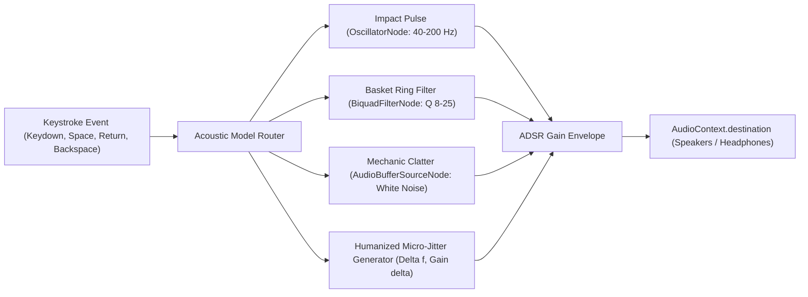

# UI Visual Presets & Procedural Typewriter Sound Studio (`docs/THEME_STUDIO.md`)
> **Domain E: Visual Studio, Audio Synthesis & Theme Engineering** | **CLI:** `arcanum theme-studio`

---

## 1. Overview & Theoretical Rationale

The **Ars Arcanum UI Theme & Procedural Sound Studio** (`src/arcanum/ui/theme.py`, `src/arcanum/ui/studio.py`, and facade `scripts/lib/ui_theme_engine.py`) delivers a 100% offline, zero-asset atmospheric aesthetic and acoustic drafting environment for speculative fiction authors.

Unlike traditional writing applications that load external fonts or MP3 audio samples over the network (violating air-gapped security and introducing latency), Ars Arcanum:
1. Synthesizes mechanical typewriter sounds purely in mathematics via the browser's **Web Audio API** using oscillator, gain, biquad filter, and noise buffer nodes.
2. Enforces WCAG AAA contrast compliance across 11 visual theme presets defined through CSS custom properties.
3. Completely adheres to an air-gapped Content-Security-Policy with zero CDN requests.

---

## 2. 11 Atmospheric Visual Presets

The theme engine defines comprehensive CSS variable token sets across 11 distinct aesthetic palettes:

| Preset Identifier | Theme Name | Primary Palette | Aesthetic Tone |
| :--- | :--- | :--- | :--- |
| `sovereign-dark` | Sovereign Dark | Obsidian void, celestial cyan, sovereign purple | Core Ars Arcanum cockpit default |
| `classic-light` | Classic Light | Slate typography on crisp ivory parchment | Traditional clean publishing manuscript |
| `retro` | Amber CRT | Phosphor terminal amber glow, vintage monospace | 1980s retrocomputing CLI experience |
| `futuristic` | Cyber Neon | Electric neon cyan, deep space void | High-altitude orbital starship cockpit |
| `retrofuturistic` | Synthwave Outrun | Hot magenta, electric cyan grid, deep violet | 1980s retro-futuristic synthwave aesthetic |
| `fantastical` | Illuminated Codex | Burnished gold, amethyst, aged vellum | Arcane medieval and fantasy manuscript |
| `grim` | Grimdark Iron | Weathered ash, desaturated iron, dried crimson | Dark fantasy and dystopian military sci-fi |
| `edgy` | Cyberpunk Terminal | Pitch black, radioactive acid green, razor crimson | High-contrast hacker and cybernetic terminal |
| `cozy` | Forest Hearth | Autumnal terracotta, hazelnut wood, matcha green | Solitary cabin, warm tea, cozy fantasy |
| `scifi` | Deep Cosmos | Deep cobalt instrumentation, starlight white | Hard sci-fi exploration vessel telemetry |
| `horror` | Abyssal Crypt | Necrotic void, bruised violet, eerie spectral green | Cosmic horror, weird fiction, eldritch gothic |

---

## 3. 10 Multi-Generation Typewriter Acoustic Models

All typewriter and keyboard sounds are synthesized dynamically via the Web Audio API without reading external audio files:



1. **`remington_1890`**: Heavy cast-iron carriage impact, deep mechanical body, antique brass resonance.
2. **`royal_1930`**: Classic mechanical typewriter slug hit, snappy metal clack, distinct release.
3. **`selectric_1960`**: Electric typeball solenoid snap, motor hum pulse, rapid corporate keystroke.
4. **`smith_corona_1980`**: Electronic portable typewriter daisywheel strike, high-speed plastic snap.
5. **`cherry_blue`**: Tactile clicky mechanical keyboard, crisp leaf pop, light bottom-out thud.
6. **`thock`**: Lubed linear switches on brass plate, deep bass acoustic pop, muffled bottom-out.
7. **`cyber_terminal`**: Retro-futuristic terminal reed relay, electronic frequency chirp, laser precision.
8. **`steampunk`**: Brass clockwork escapement tick, miniature steam hiss, precision gear click.
9. **`scribe_quill`**: Parchment surface friction scratch, ink flow stroke, delicate nib tap.
10. **`gothic_relic`**: Stone tablet impact, heavy chisel thud, flint resonance ping.

### Mathematical & Acoustic Foundations
$$\Delta f = f_0 \cdot (1 + \epsilon), \quad \epsilon \sim \mathcal{U}(-0.04, +0.04)$$
$$\text{Gain } G = G_0 \cdot (1 + \delta), \quad \delta \sim \mathcal{U}(-0.10, +0.10)$$

Special physical key sound generators:
- **Spacebar**: Low-frequency resonant wooden/chassis body thud ($\sim 115\text{ Hz} \to 45\text{ Hz}$).
- **Enter**: Carriage return slide friction + dual harmonic brass bell chime ($1760\text{ Hz} + 3520\text{ Hz}$).
- **Backspace**: Double-click escapement ratchet clack ($2400\text{ Hz}$).

---

## 4. Air-Gapped Content Security Policy Guarantee

Every generated report and visualizer studio enforces strict air-gapped isolation:
```html
<meta http-equiv="Content-Security-Policy" content="default-src 'none'; style-src 'unsafe-inline'; script-src 'unsafe-inline'; img-src data:; media-src data: blob:;">
```

---

## 5. Usage & CLI Dispatch

```bash
# 1. Launch interactive standalone Theme Studio in browser
arcanum theme-studio --open

# 2. Export standalone HTML studio
arcanum theme-studio --html dist/theme_studio.html

# 3. Set initial visual preset and sound model
arcanum theme-studio -p retro -s remington_1890

# 4. Configure visual theme via CLI
arcanum config theme retro
arcanum config sound-preset royal_1930
```

---

## Production CLI & Continuity Cross-Reference

| Capability | Command | Native Engine | Compatibility Facade |
| :--- | :--- | :--- | :--- |
| **Visual Studio Cockpit** | `python scripts/arcanum studio [VAULT] [--port 4242]` | `src.arcanum.server.daemon` | `scripts/lib/studio_server.py` |
| **Unified Continuity Suite** | `python scripts/arcanum continuity-suite [VAULT]` | `src.arcanum.worldbible.runner` | `scripts/lib/vault_continuity_runner.py` |
| **Phase-Aware Effort Points** | `python scripts/arcanum sprint-effort [ARGS]` | `src.arcanum.manuscript.velocity` | `scripts/lib/phase_effort_engine.py` |
| **Epistemic POV Firewall** | `python scripts/arcanum validate-epistemic [VAULT]` | `src.arcanum.worldbible.epistemics` | `scripts/lib/epistemic_firewall.py` |
| **Timeline & Route Physics** | `python scripts/arcanum timeline-audit [VAULT]` | `src.arcanum.worldbible.timeline` | `scripts/lib/timeline_solver.py` |
| **PolyGlot Conlang Linter** | `python scripts/arcanum conlang-check [ARGS]` | `src.arcanum.worldbible.conlang` | `scripts/lib/conlang_linter.py` |
| **Resource Conservation Ledger** | `python scripts/arcanum ledger-audit [VAULT]` | `src.arcanum.worldbible.ledger` | `scripts/lib/resource_ledger.py` |
| **Multi-POV Narrative Braid** | `python scripts/arcanum braid [MANUSCRIPT]` | `src.arcanum.manuscript.braid` | `scripts/lib/narrative_braid.py` |
| **Prose Word & Dialogue Metrics** | `python scripts/arcanum count-words [FILE/VAULT]` | `src.arcanum.manuscript.word_counter` | `scripts/lib/word_counter.py` |
| **Fast Paragraph Diff & Scraps** | `python scripts/arcanum diff-fast OLD.md NEW.md` | `src.arcanum.manuscript.diff` | `scripts/lib/diff_core.py` |
| **Word Tracked Changes Sync** | `python scripts/arcanum docx-tracked [export/pull]` | `src.arcanum.publishing.docx` | `scripts/lib/docx_tracked_changes.py` |
| **Multi-Format Publishing** | `python scripts/arcanum publish [MANUSCRIPT] --format ...` | `src.arcanum.publishing.publisher` | `scripts/lib/publisher.py` |
| **System Diagnostics & Doctor** | `python scripts/arcanum doctor [VAULT]` | `src.arcanum.core.diagnostics` | `scripts/lib/diagnostics.py` |
| **Schema Migration Engine** | `python scripts/arcanum migrate [VAULT]` | `src.arcanum.core.migrate` | `scripts/lib/migrate.py` |
