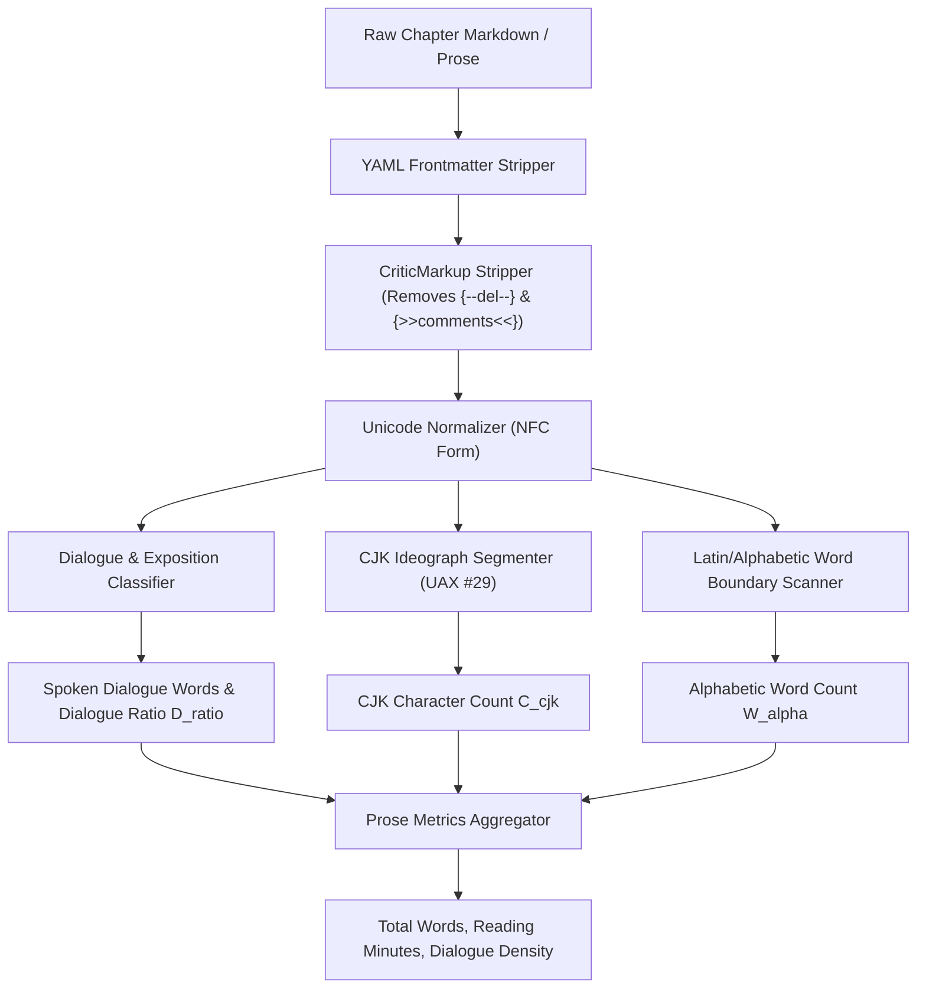

# Prose Word Counter & Literary Metrics Engine (`docs/WORD_COUNTER.md`)
> **Domain B: Manuscript Engineering & Telemetry** | **CLI:** `arcanum count-words` / `arcanum word-metrics`

---

## 1. Overview & Theoretical Rationale

The **Ars Arcanum Word Counter Engine** (`src/arcanum/manuscript/word_counter.py` and facade `scripts/lib/word_counter.py`) provides deterministic, Unicode-aware prose metrics, CriticMarkup revision stripping, dialogue ratio calculation, CJK ideograph segmentation, and reading time estimations for speculative fiction novelists and manuscript editors.

Standard naive word counters (`wc -w` or basic `text.split()`) produce inaccurate metrics for fiction manuscripts:
1. **CriticMarkup Inaccuracies**: Naive word counters count deleted text (`{--deleted prose--}`) and editorial remarks (`{>>comment<<}`) as part of the book's word count.
2. **CJK & Ideographic Scripts**: Chinese, Japanese, and Korean characters lack whitespace separators, causing naive whitespace splitters to count whole paragraphs as single words.
3. **Dialogue vs. Narrative Density**: Pacing and character presence depend heavily on the proportion of spoken dialogue to scenic exposition.
4. **Hyphenated Compounds & Punctuation**: Em-dashes (`—`), ellipses (`...`), and hyphenated compounds require consistent tokenization rules to align with publishing industry standards (e.g., standard manuscript guidelines).

---

## 2. Mathematical Formalism & Tokenization Pipeline



### 2.1 The Unified Word Count Metric ($W_{\text{total}}$)
For a given manuscript chapter, let $W_{\text{alpha}}$ be the number of whitespace/punctuation-bounded alphabetic words, and $C_{\text{cjk}}$ be the count of individual CJK ideographs (Unicode ranges `\u4e00-\u9fff`, `\u3400-\u4dbf`, etc.):

$$W_{\text{total}} = W_{\text{alpha}} + C_{\text{cjk}}$$

### 2.2 Dialogue Ratio Metric ($\mathcal{D}_{\text{ratio}}$)
Let $W_{\text{dialogue}}$ be words enclosed within quote marks (`"..."`, `“...”`, `‘...’`, or `«...»`):

$$\mathcal{D}_{\text{ratio}} = \frac{W_{\text{dialogue}}}{W_{\text{total}}} \in [0.0, 1.0]$$

- **$\mathcal{D}_{\text{ratio}} < 0.20$**: Heavy exposition / scenic worldbuilding description.
- **$0.20 \le \mathcal{D}_{\text{ratio}} \le 0.50$**: Balanced dramatic novelistic prose.
- **$\mathcal{D}_{\text{ratio}} > 0.50$**: Dialogue-dense, fast-paced theatrical scene.

### 2.3 Estimated Reading Time ($T_{\text{read}}$)
Standard publishing metrics estimate silent reading velocity at 250 words per minute (wpm):

$$T_{\text{read}} = \frac{W_{\text{total}}}{250.0} \text{ minutes}$$

---

## 3. Supported Markup & Stripping Rules

| Format Element | Syntax Pattern | Processing Rule | Rationale |
| :--- | :--- | :--- | :--- |
| **CriticMarkup Addition** | `{++new text++}` | Preserved as prose | Counted as current manuscript text |
| **CriticMarkup Deletion** | `{--removed text--}` | Stripped out | Author has removed this prose |
| **CriticMarkup Substitution**| `{~~old~>new~~}` | Replaced with `new` | Only replacement text counts |
| **CriticMarkup Comment** | `{>>editorial remark<<}` | Stripped out | Editorial comments are not prose |
| **CriticMarkup Highlight** | `{==highlighted==}` | Highlight removed, text kept | Base text remains |
| **YAML Frontmatter** | `--- ... ---` | Header stripped | Metadata does not count toward book length |
| **Obsidian Wikilinks** | `[[Entity\|Alias]]` | Replaced with `Alias` | Matches reading flow of publication |

---

## 4. CLI Execution & Option Reference

```bash
# 1. Count words for a single chapter
arcanum count-words Manuscripts/Book-01/01_Chapter.md

# 2. Count words across an entire manuscript vault with act breakdowns
arcanum count-words Manuscripts/Book-01/

# 3. Output structured JSON telemetry for automated analysis
arcanum count-words Manuscripts/Book-01/ --json

# 4. Display dialogue ratio and character speech density
arcanum count-words Manuscripts/Book-01/ --detailed
```

---

## 5. Module Implementation & Architecture

- **Native Package**: [`src/arcanum/manuscript/word_counter.py`](../src/arcanum/manuscript/word_counter.py)
- **Compatibility Facade**: [`scripts/lib/word_counter.py`](../scripts/lib/word_counter.py)
- **Unit Test Suite**: [`tests/test_manuscript_word_counter_native.py`](../tests/test_manuscript_word_counter_native.py)

---

## Production CLI & Continuity Cross-Reference

| Capability | Command | Native Engine | Compatibility Facade |
| :--- | :--- | :--- | :--- |
| **Visual Studio Cockpit** | `python scripts/arcanum studio [VAULT] [--port 4242]` | `src.arcanum.server.daemon` | `scripts/lib/studio_server.py` |
| **Unified Continuity Suite** | `python scripts/arcanum continuity-suite [VAULT]` | `src.arcanum.worldbible.runner` | `scripts/lib/vault_continuity_runner.py` |
| **Phase-Aware Effort Points** | `python scripts/arcanum sprint-effort [ARGS]` | `src.arcanum.manuscript.velocity` | `scripts/lib/phase_effort_engine.py` |
| **Epistemic POV Firewall** | `python scripts/arcanum validate-epistemic [VAULT]` | `src.arcanum.worldbible.epistemics` | `scripts/lib/epistemic_firewall.py` |
| **Timeline & Route Physics** | `python scripts/arcanum timeline-audit [VAULT]` | `src.arcanum.worldbible.timeline` | `scripts/lib/timeline_solver.py` |
| **PolyGlot Conlang Linter** | `python scripts/arcanum conlang-check [ARGS]` | `src.arcanum.worldbible.conlang` | `scripts/lib/conlang_linter.py` |
| **Resource Conservation Ledger** | `python scripts/arcanum ledger-audit [VAULT]` | `src.arcanum.worldbible.ledger` | `scripts/lib/resource_ledger.py` |
| **Multi-POV Narrative Braid** | `python scripts/arcanum braid [MANUSCRIPT]` | `src.arcanum.manuscript.braid` | `scripts/lib/narrative_braid.py` |
| **Prose Word & Dialogue Metrics** | `python scripts/arcanum count-words [FILE/VAULT]` | `src.arcanum.manuscript.word_counter` | `scripts/lib/word_counter.py` |
| **Fast Paragraph Diff & Scraps** | `python scripts/arcanum diff-fast OLD.md NEW.md` | `src.arcanum.manuscript.diff` | `scripts/lib/diff_core.py` |
| **Word Tracked Changes Sync** | `python scripts/arcanum docx-tracked [export/pull]` | `src.arcanum.publishing.docx` | `scripts/lib/docx_tracked_changes.py` |
| **Multi-Format Publishing** | `python scripts/arcanum publish [MANUSCRIPT] --format ...` | `src.arcanum.publishing.publisher` | `scripts/lib/publisher.py` |
| **System Diagnostics & Doctor** | `python scripts/arcanum doctor [VAULT]` | `src.arcanum.core.diagnostics` | `scripts/lib/diagnostics.py` |
| **Schema Migration Engine** | `python scripts/arcanum migrate [VAULT]` | `src.arcanum.core.migrate` | `scripts/lib/migrate.py` |
