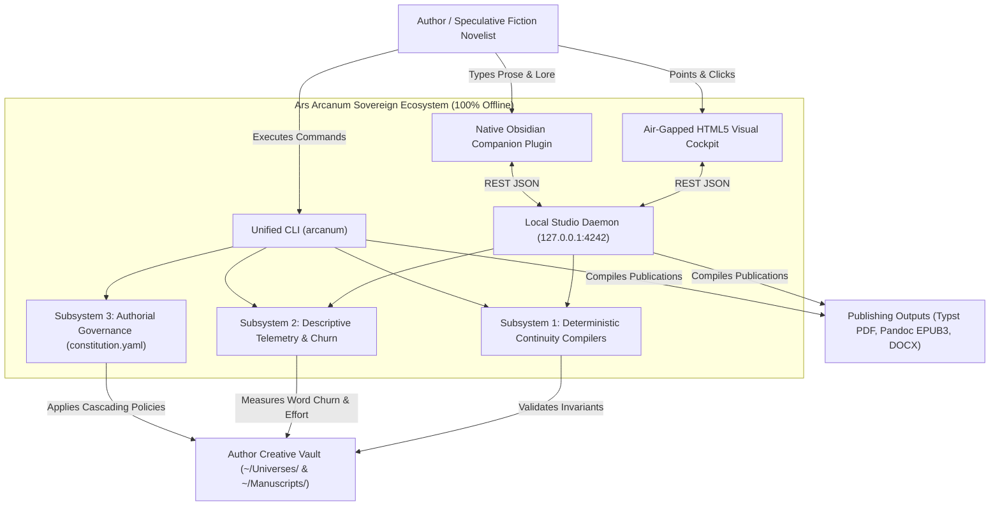
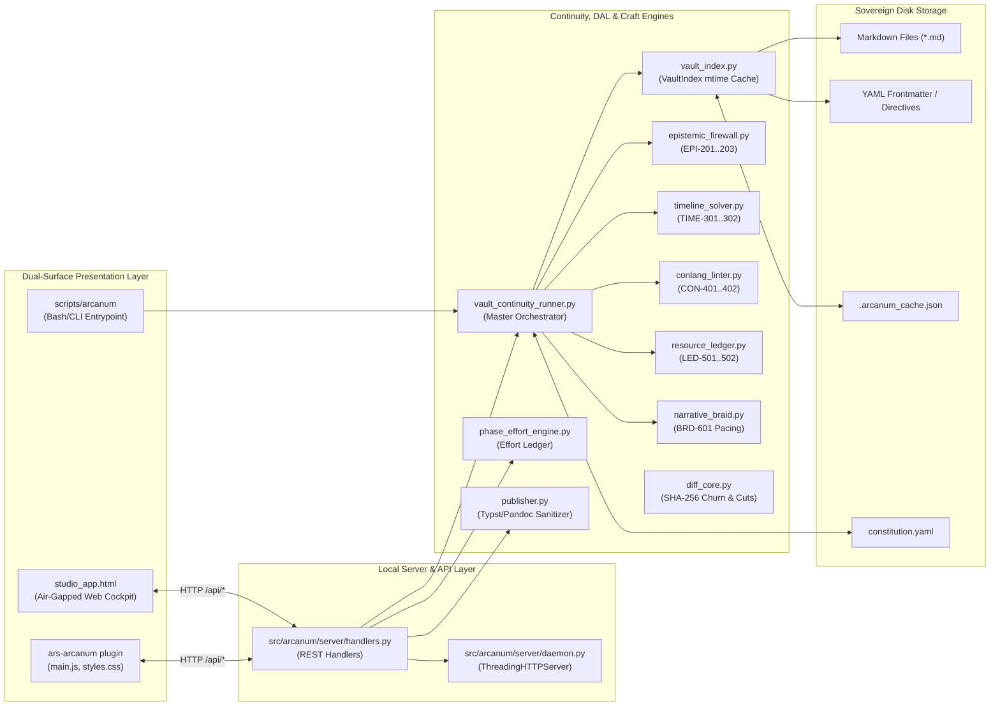
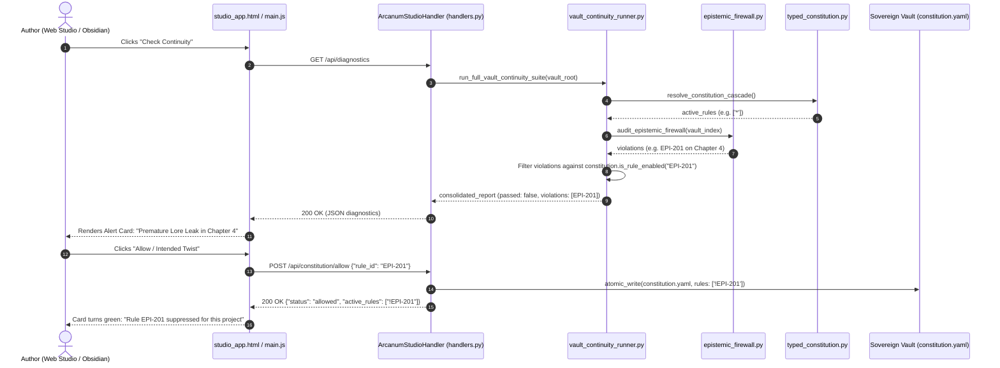
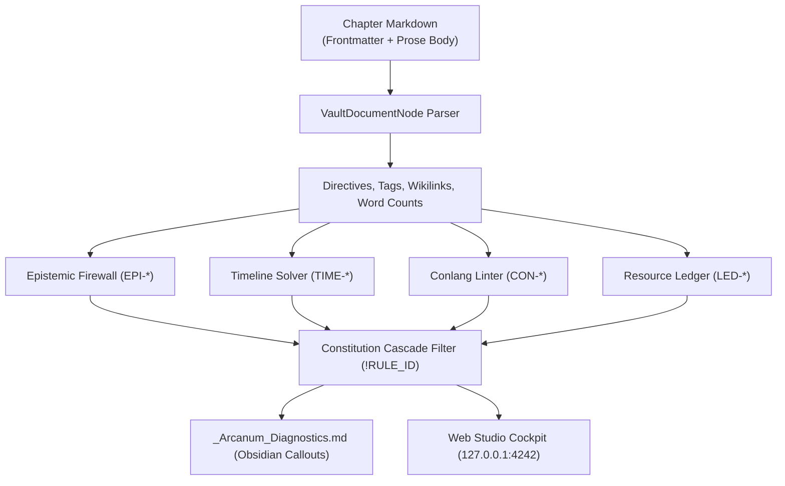

# Ars Arcanum — Master System Architecture & Engineering Blueprint
`docs/codebase/ARCHITECTURE.md`

> **Snapshot Identity**: Anchored to commit `e5aaae18bc9b7e386bab777984120c71bc53f199` (`main`) | Release `v0.1.0` | 100% Sovereign Offline Architecture

---

## Part 1 — Whole-Repository Technical Deep-Dive

### 1.1 Repository Identity & Mission
**Ars Arcanum** (Scriptorium) is an open-source, local-first, 100% offline sovereign worldbuilding, narrative continuity, and manuscript engineering operating system designed for speculative fiction (Science Fiction & Fantasy) novelists, storytellers, and worldbuilders ([`README.md#L10`](../../README.md#L10)). It treats the author's narrative vault (`~/Universes/` and `~/Manuscripts/`) as a compilable software repository, enforcing deterministic mathematical, chronological, spatial, linguistic, and epistemic invariants without probabilistic AI hallucination or external network transmission ([`AGENTS.md#L7-L14`](../../AGENTS.md#L7-L14)).

### 1.2 Tech-Stack Detection Table

| Layer | Technology | Version / Pinned Constraint | Evidence (File & Line) |
| :--- | :--- | :--- | :--- |
| **Core Runtime** | Python Standard Library | `>=3.10` (Target: Python 3.10–3.14) | [`pyproject.toml#L10`](../../pyproject.toml#L10), [`AGENTS.md#L28-L30`](../../AGENTS.md#L28-L30) |
| **Build Backend** | `setuptools` | `>=61.0` | [`pyproject.toml#L2-L3`](../../pyproject.toml#L2-L3) |
| **Static Linter & Formatter** | `ruff` | `0.16.8` (Target `py310`) | [`pyproject.toml#L20-L59`](../../pyproject.toml#L20-L59), [`.github/workflows/ci.yml#L58`](../../.github/workflows/ci.yml#L58) |
| **Static Type Checker** | `mypy` | `1.15.0` (Strict on refactored core) | [`mypy.ini#L1-L35`](../../mypy.ini#L1-L35), [`.github/workflows/ci.yml#L63`](../../.github/workflows/ci.yml#L63) |
| **Security SAST Scanner** | `bandit` | `1.8.3` (`-ll -ii`) | [`AGENTS.md#L12`](../../AGENTS.md#L12), [`.github/workflows/ci.yml#L68-L69`](../../.github/workflows/ci.yml#L68-L69) |
| **Secret Scanner** | `gitleaks` | `v3.0.0` (Pinned Action) | [`.github/workflows/ci.yml#L51-L55`](../../.github/workflows/ci.yml#L51-L55) |
| **Shell Validator** | `shellcheck` / `bash -n` | Warning level (`-S warning`) | [`.github/workflows/ci.yml#L82-L98`](../../.github/workflows/ci.yml#L82-L98) |
| **Test & Coverage Runner** | `unittest` / `coverage.py` | `coverage 7.6.12` / `7.15.1` (Fail under: 80%) | [`pyproject.toml#L60-L80`](../../pyproject.toml#L60-L80), [`.github/workflows/ci.yml#L78-L80`](../../.github/workflows/ci.yml#L78-L80) |
| **Local Studio Daemon** | `http.server.ThreadingHTTPServer` | Standard Library (`127.0.0.1:4242`) | [`src/arcanum/server/daemon.py#L10-L26`](../../src/arcanum/server/daemon.py#L10-L26) |
| **Visual Studio UI** | Single-File HTML5/CSS3/JS | Air-gapped, Zero-CDN, Strict CSP | [`src/arcanum/ui/studio_app.html#L7-L13`](../../src/arcanum/ui/studio_app.html#L7-L13) |
| **Desktop Companion** | Obsidian Native Plugin | Obsidian API v1.0+ (`manifest.json`) | [`templates/world-bible/.obsidian/plugins/ars-arcanum/manifest.json#L1-L10`](../../templates/world-bible/.obsidian/plugins/ars-arcanum/manifest.json#L1-L10) |
| **Publishing (Print PDF)** | Typst CLI | `0.14.2` (Optional accelerator) | [`scripts/lib/publisher.py#L116-L140`](../../scripts/lib/publisher.py#L116-L140), [`.github/workflows/ci.yml#L41`](../../.github/workflows/ci.yml#L41) |
| **Publishing (EPUB/DOCX)** | Pandoc CLI | Optional accelerator | [`scripts/lib/publisher.py#L170-L220`](../../scripts/lib/publisher.py#L170-L220), [`.github/workflows/ci.yml#L36`](../../.github/workflows/ci.yml#L36) |
| **Tracked Changes Engine** | `xml.etree.ElementTree` | Standard Library DOM Parser | [`scripts/lib/docx_tracked_changes.py#L20-L60`](../../scripts/lib/docx_tracked_changes.py#L20-L60) |
| **Transactional Storage** | Atomic File Swaps + SQLite FTS5 | Standard Library `sqlite3`, `tempfile` | [`scripts/lib/vault_index.py#L84-L114`](../../scripts/lib/vault_index.py#L84-L114), [`scripts/lib/vault_search.py#L25-L60`](../../scripts/lib/vault_search.py#L25-L60) |

---

### 1.3 System Entry Points

1. **Unified CLI Gateway** (`arcanum` / `ars-arcanum`):
   - Entry point: `scripts.lib.cli:main` registered via `pyproject.toml` (`[project.scripts]`) ([`pyproject.toml#L12-L14`](../../pyproject.toml#L12-L14)).
   - Dispatches subcommands through `scripts/lib/cli_handlers.py` ([`scripts/lib/cli_handlers.py#L40-L120`](../../scripts/lib/cli_handlers.py#L40-L120)) and `scripts/lib/cli.py` ([`scripts/lib/cli.py#L150-L320`](../../scripts/lib/cli.py#L150-L320)).
2. **Sovereign Local Studio Daemon** (`arcanum studio`):
   - Entry point: `src.arcanum.server.daemon:main` ([`src/arcanum/server/daemon.py#L60-L81`](../../src/arcanum/server/daemon.py#L60-L81)) and compatibility shim [`scripts/lib/studio_server.py#L12-L17`](../../scripts/lib/studio_server.py#L12-L17).
   - Serves the air-gapped HTML5 Visual Studio at `http://127.0.0.1:4242` and exposes REST APIs for the native Obsidian Companion Plugin.
3. **Native Obsidian Companion Plugin** (`ars-arcanum`):
   - Entry point: `templates/world-bible/.obsidian/plugins/ars-arcanum/main.js` ([`templates/world-bible/.obsidian/plugins/ars-arcanum/main.js#L1-L85`](../../templates/world-bible/.obsidian/plugins/ars-arcanum/main.js#L1-L85)).
   - Renders a status bar continuity badge, adds command palette shortcuts, and provides a one-click ribbon icon opening the Visual Studio.
4. **Desktop Windows Shortcut & Setup Script**:
   - Entry point: `scripts/setup_arcanum.ps1` ([`scripts/setup_arcanum.ps1#L1-L150`](../../scripts/setup_arcanum.ps1#L1-L150)).
   - Configures PowerShell execution, validates Python `>=3.10`, and creates a Desktop shortcut launching `arcanum studio --open`.

---

### 1.4 Commands & Verification Inventory

| Command | Purpose | Evidence | CI Gate / Enforced Status |
| :--- | :--- | :--- | :--- |
| `python -m unittest discover -s tests -p "test_*.py"` | Run full test suite (540 tests) | [`tests/`](../../tests/), [`pyproject.toml#L60`](../../pyproject.toml#L60) | Enforced in CI ([`.github/workflows/ci.yml#L79`](../../.github/workflows/ci.yml#L79)) |
| `python -m coverage run -m unittest discover -s tests -p "test_*.py"` | Measure code execution branch coverage | [`pyproject.toml#L60-L80`](../../pyproject.toml#L60-L80) | Enforced ($\ge 80\%$ floor) ([`.github/workflows/ci.yml#L80`](../../.github/workflows/ci.yml#L80)) |
| `ruff check .` | AST linting, style, and security rules | [`pyproject.toml#L20-L59`](../../pyproject.toml#L20-L59) | Enforced in CI ([`.github/workflows/ci.yml#L59`](../../.github/workflows/ci.yml#L59)) |
| `mypy --config-file mypy.ini --explicit-package-bases scripts src tests` | Static type checking (152 source files) | [`mypy.ini#L1-L35`](../../mypy.ini#L1-L35) | Enforced in CI ([`.github/workflows/ci.yml#L64`](../../.github/workflows/ci.yml#L64)) |
| `bandit -r scripts/lib src/arcanum -ll -ii` | Python AST vulnerability and injection audit | [`AGENTS.md#L12`](../../AGENTS.md#L12) | Enforced in CI ([`.github/workflows/ci.yml#L69`](../../.github/workflows/ci.yml#L69)) |
| `gitleaks detect` | Prevent credential or secret leakage | [`.github/workflows/ci.yml#L51-L55`](../../.github/workflows/ci.yml#L51-L55) | Enforced via GitHub Action |
| `bash -n scripts/*.sh scripts/arcanum` | Syntax validation for POSIX wrappers | [`.github/workflows/ci.yml#L82-L95`](../../.github/workflows/ci.yml#L82-L95) | Enforced in CI |
| `shellcheck -S warning scripts/*.sh scripts/arcanum` | Static analysis for shell wrappers | [`.github/workflows/ci.yml#L98`](../../.github/workflows/ci.yml#L98) | Enforced in CI |
| `python -m build --wheel && pip install dist/*.whl` | Validate wheel build and CLI entry points | [`.github/workflows/ci.yml#L100-L115`](../../.github/workflows/ci.yml#L100-L115) | Enforced in CI |
| `arcanum studio [VAULT] [--port 4242]` | Launch local HTTP studio server and browser UI | [`src/arcanum/server/daemon.py#L60-L78`](../../src/arcanum/server/daemon.py#L60-L78) | Verified via [`tests/test_studio_server.py`](../../tests/test_studio_server.py) |
| `arcanum continuity-suite [VAULT]` | Run all 4 continuity compilers and update dashboard | [`scripts/lib/vault_continuity_runner.py#L38-L130`](../../scripts/lib/vault_continuity_runner.py#L38-L130) | Verified in unit and CI runs |
| `arcanum sprint-effort [ARGS]` | Calculate and log phase-aware effort points | [`scripts/lib/phase_effort_engine.py#L280-L360`](../../scripts/lib/phase_effort_engine.py#L280-L360) | Verified in unit and CI runs |
| `arcanum validate-epistemic [VAULT]` | Check POV knowledge barriers (`EPI-201..203`) | [`scripts/lib/epistemic_firewall.py#L120-L240`](../../scripts/lib/epistemic_firewall.py#L120-L240) | Verified in unit and CI runs |
| `arcanum timeline-audit [VAULT]` | Check timeline regressions & route physics (`TIME-301..302`) | [`scripts/lib/timeline_solver.py#L180-L310`](../../scripts/lib/timeline_solver.py#L180-L310) | Verified in unit and CI runs |
| `arcanum conlang-check [ARGS]` | Audit PolyGlot dictionary & syllable phonotactics (`CON-401..402`) | [`scripts/lib/conlang_linter.py#L140-L240`](../../scripts/lib/conlang_linter.py#L140-L240) | Verified in unit and CI runs |
| `arcanum ledger-audit [VAULT]` | Audit resource conservation pools (`LED-501..502`) | [`scripts/lib/resource_ledger.py#L120-L210`](../../scripts/lib/resource_ledger.py#L120-L210) | Verified in unit and CI runs |
| `arcanum braid [MANUSCRIPT]` | Generate POV pacing & drought telemetry (`BRD-601`) | [`scripts/lib/narrative_braid.py#L160-L240`](../../scripts/lib/narrative_braid.py#L160-L240) | Verified in unit and CI runs |
| `arcanum diff-fast OLD NEW` | SHA-256 paragraph diff & excise cuts $\ge 50$ words | [`scripts/lib/diff_core.py#L347-L368`](../../scripts/lib/diff_core.py#L347-L368) | Verified in unit and CI runs |
| `arcanum docx-tracked [export/pull]` | Bidirectional CriticMarkup $\leftrightarrow$ Word Tracked Changes | [`scripts/lib/docx_tracked_changes.py#L300-L360`](../../scripts/lib/docx_tracked_changes.py#L300-L360) | Verified in unit and CI runs |
| `arcanum publish [MANUSCRIPT] [--format fmt]` | Compile prose to sanitized Typst PDF, EPUB3, or DOCX | [`scripts/lib/publisher.py#L400-L490`](../../scripts/lib/publisher.py#L400-L490) | Verified in unit and CI runs |

*CI Enforcement Note*: Both `.github/workflows/ci.yml` and `.github/workflows/narrative-continuity-ci.yml` run on `push` and `pull_request` to `main`, plus weekly drift cron (`23 4 * * 1`). Required status checks on GitHub block merges if any step fails.

---

### 1.5 Directory & Module Layout

```text
7-Scriptorium/
├── .github/workflows/             # Continuous integration and matrix pipelines
│   ├── ci.yml                     # Primary multi-linter, SAST, coverage, and wheel test
│   └── narrative-continuity-ci.yml# Python 3.10/3.11/3.12 multi-version continuity matrix
├── configs/                       # Static JSON configuration files and seed rules
│   ├── idioms.json                # Speculative idiom templates and cultural presets
│   ├── leechblock_arcanum_rules.json # Distraction-blocking firewall configurations
│   └── plugin_catalog.json        # Curated catalog of tested Obsidian companion plugins
├── docs/                          # Comprehensive technical manual and craft guides
│   ├── adr/                       # Architectural Decision Records (ADR-0001, etc.)
│   ├── audit/                     # Verification and historical refactor audit reports
│   ├── codebase/                  # Cited codebase architecture, testing, and stack guides
│   └── guides/                    # Author tutorials, backup setup, typography, and plugins
├── scripts/                       # Unified CLI and core standard library engines
│   ├── arcanum                    # Bash executable CLI wrapper with auto-Python detection
│   ├── ars-arcanum                # Alternate symlink entrypoint for POSIX package managers
│   ├── setup_arcanum.ps1          # Zero-conf Windows desktop shortcut and environment installer
│   ├── sync_and_verify_docs.py    # Documentation cross-reference and integrity synchronizer
│   └── lib/                       # 64 production Python modules (100% zero-pip standard library)
│       ├── cli.py                 # Argument parsing and primary CLI dispatch hub
│       ├── cli_handlers.py        # Handler registry mapping commands to engine modules
│       ├── diff_core.py           # SHA-256 paragraph hashing, revision churn, draft promotion
│       ├── docx_tracked_changes.py# XML DOM bidirectional CriticMarkup / Word sync
│       ├── epistemic_firewall.py  # Character POV secret discovery and knowledge firewall (EPI-*)
│       ├── fs_utils.py            # Transactional atomic writes, retry backoff, path safety
│       ├── lockfile.py            # Cross-platform advisory locking (fcntl / msvcrt)
│       ├── narrative_braid.py     # POV rotation tracking, drought detector, SVG braider (BRD-*)
│       ├── phase_effort_engine.py # Phase-aware effort points, sprint ledger, burnout warnings
│       ├── plugin_sandbox.py      # Subprocess Python isolation for user-defined plugins
│       ├── publisher.py           # Typst/Pandoc publication compiler and prose sanitizer
│       ├── resource_ledger.py     # Hard magic and sci-fi resource conservation auditor (LED-*)
│       ├── studio_server.py       # Bridge shim for local visual web studio CLI command
│       ├── timeline_solver.py     # Multi-hop Dijkstra route physics & planetary calendars (TIME-*)
│       ├── typed_constitution.py  # YAML policy cascades, rule negation (!RULE_ID), frozen models
│       ├── vault_continuity_runner.py # Unified continuity suite and _Arcanum_Diagnostics.md bridge
│       └── vault_index.py         # Mtime-cached single Data Access Layer (DAL) for markdown vaults
├── src/arcanum/                   # Structured modern package tree (re-exported and layered)
│   ├── core/                      # Transactional I/O, path confinement, locking, and DAL
│   ├── manuscript/                # Diffing, effort telemetry, narrative braid, sprint engines
│   ├── worldbible/                # Epistemic firewall, timeline physics, conlang, and resource ledger
│   ├── publishing/                # Tracked changes, Typst/Pandoc publishers, preflight validation
│   ├── ui/                        # Air-gapped single-file HTML5/CSS3/JS Visual Studio Cockpit
│   └── server/                    # Lightweight standard library ThreadingHTTPServer daemon and APIs
├── templates/                     # Sovereign creative vault templates and Obsidian seed files
│   ├── demo-cosmos/               # Sample fantasy cosmos (Eldoria) for continuity integration testing
│   ├── manuscript/                # Clean novel scaffold with act/chapter metadata structures
│   └── world-bible/               # Complete worldbuilding vault seed (.rootweave, fileClasses)
│       └── .obsidian/plugins/ars-arcanum/ # Native TypeScript Obsidian companion plugin
├── tests/                         # 58 standard library unittest test suites (540 passing tests)
├── pyproject.toml                 # Package definition, ruff config, and coverage thresholds
├── mypy.ini                       # Strict static typing rules and module exclusions
└── AGENTS.md                      # Sovereign manifesto, safety contracts, and momentum queues
```

---

### 1.6 Deployment & Runtime Surface

| Runtime / Tool | Specification | Surface Pinning Evidence |
| :--- | :--- | :--- |
| **Language Runtime** | Python 3.10, 3.11, 3.12, 3.13, 3.14 | [`pyproject.toml#L10`](../../pyproject.toml#L10), [`.github/workflows/narrative-continuity-ci.yml#L24`](../../.github/workflows/narrative-continuity-ci.yml#L24) |
| **Primary CI Runner** | Ubuntu 24.04 LTS (`noble`) | [`.github/workflows/ci.yml#L20`](../../.github/workflows/ci.yml#L20), [`.github/workflows/narrative-continuity-ci.yml#L20`](../../.github/workflows/narrative-continuity-ci.yml#L20) |
| **GitHub Actions SHAs** | Full 40-character commit hashes | `actions/checkout@3d3c4...`, `actions/setup-python@5fda3...` ([`.github/workflows/ci.yml#L24-L29`](../../.github/workflows/ci.yml#L24-L29)) |
| **Typst Compiler** | `typst 0.14.2` | [`.github/workflows/ci.yml#L39-L41`](../../.github/workflows/ci.yml#L39-L41) |
| **Local Host Binding** | `127.0.0.1:4242` | Strictly loopback bound in [`src/arcanum/server/daemon.py#L26`](../../src/arcanum/server/daemon.py#L26) |

### 1.7 EOL & Dead-Dependency Scan
- **Third-Party PyPI Packages**: **0 runtime dependencies**. The production execution runtime is 100% built on the Python standard library. It is immune to supply-chain package takeovers, dependency rot, or deprecations.
- **Python Version EOL**: Support begins at Python 3.10 (active security fixes). CI tests against 3.10, 3.11, and 3.12, while local development verifies against Python 3.14.
- **External Publishing Binaries**: `typst` and `pandoc` are optional publishing accelerators invoked safely via list-form `subprocess.run()`. If missing, the system emits descriptive warning diagnostics without crashing core continuity audits.

---

## Part 2 — Context & Ecosystem

### 2.1 Local Checkout Identity

| Attribute | Local Value | Source Verification |
| :--- | :--- | :--- |
| **Remote Origin** | `https://github.com/aryansinghnagar/Ars-Arcanum.git` | `git remote -v` |
| **Active Branch** | `main` | `git branch --show-current` |
| **HEAD Commit** | `e5aaae18bc9b7e386bab777984120c71bc53f199` | `git log -1` |
| **Project Version** | `0.1.0` | [`pyproject.toml#L7`](../../pyproject.toml#L7), [`src/arcanum/__init__.py#L4`](../../src/arcanum/__init__.py#L4) |
| **License** | MIT License | [`LICENSE`](../../LICENSE), [`README.md#L7`](../../README.md#L7) |

### 2.2 Agentic & Engineering Contracts ([`AGENTS.md`](../../AGENTS.md))

The repository enforces five immutable engineering contracts:
1. **Atomic File Writes**: All writes to cache files, manuscripts, logs, and diagnostics must use `atomic_write()` (staged via `tempfile.mkstemp`, flushed with `os.fsync()`, and promoted via `os.replace()` with exponential backoff on Windows) ([`AGENTS.md#L19-L20`](../../AGENTS.md#L19-L20), [`scripts/lib/vault_index.py#L84-L114`](../../scripts/lib/vault_index.py#L84-L114)).
2. **Cross-Platform Advisory Locking**: Concurrent CLI, daemon, and watcher access acquires `ArcanumLock` (`fcntl.flock` on POSIX, `msvcrt.locking` on Windows) ([`AGENTS.md#L22-L23`](../../AGENTS.md#L22-L23), [`scripts/lib/lockfile.py#L43-L100`](../../scripts/lib/lockfile.py#L43-L100)).
3. **Path Traversal Defense**: All file readers and exporters strictly validate subpaths with `is_safe_subpath(root, candidate)` before touching disk, raising `PathSecurityError` on symlink or `..` directory escapes ([`AGENTS.md#L25-L26`](../../AGENTS.md#L25-L26), [`scripts/lib/vault_index.py#L70-L81`](../../scripts/lib/vault_index.py#L70-L81)).
4. **Zero-Pip Dependency Guarantee**: Runtime code relies solely on standard library modules (`json`, `xml.etree.ElementTree`, `zipfile`, `difflib`, `hashlib`, `sqlite3`, `http.server`) ([`AGENTS.md#L28-L30`](../../AGENTS.md#L28-L30)).
5. **Content-Security-Policy (CSP)**: All generated HTML/SVG files embed `<meta http-equiv="Content-Security-Policy" content="default-src 'none'; style-src 'unsafe-inline'; img-src data:;">` and contain zero external CDN script/link tags ([`AGENTS.md#L31-L33`](../../AGENTS.md#L31-L33)).

### 2.3 Developer Gotchas & Platform Quirks

1. **Windows Indexer Lock Contention**: On Windows, desktop file indexers (Obsidian search, Windows Search, antivirus) frequently hold transient read locks on recently saved files. `atomic_write()` absorbs these with an exponential backoff loop (up to 5 attempts across 320ms) before re-raising `PermissionError` ([`scripts/lib/vault_index.py#L104-L111`](../../scripts/lib/vault_index.py#L104-L111)).
2. **Draft Baseline Read-Only Permissions**: `promote_draft_hardlinked()` promotes draft versions using `shutil.copy2` (ensuring physical disk inode separation) and sets `0o444` read-only permissions on the parent draft directory. To modify a promoted parent draft, the read-only flag must be explicitly lifted ([`scripts/lib/diff_core.py#L316-L321`](../../scripts/lib/diff_core.py#L316-L321)).
3. **Python 3.10 F-String Backslash Rule**: Python 3.10 and 3.11 forbid backslashes (`\"`) inside f-string expressions. All quotes or escaped characters embedded into HTML/SVG templates must be pre-formatted into distinct local variables before string substitution.
4. **Air-Gapped Local Server**: The local studio server only binds to `127.0.0.1` and will refuse non-loopback connections.

---

## Part 3 — Architectural Blueprint

### 3.1 C4 Architecture Models

#### Level 1: System Context Diagram



#### Level 2: Container Diagram (Internal Modules & Boundaries)



#### Level 3: Representative Request Lifecycle (Continuity & 1-Click Twist Allowance)



---

### 3.2 Cross-Cutting Concerns Matrix

| Concern | Implementation Strategy | Evidence (File & Line) |
| :--- | :--- | :--- |
| **Authentication & Confinement** | Air-gapped loopback binding to `127.0.0.1`; CORS restricted to local origin; zero network transmission | [`src/arcanum/server/daemon.py#L26`](../../src/arcanum/server/daemon.py#L26), [`src/arcanum/server/handlers.py#L40-L44`](../../src/arcanum/server/handlers.py#L40-L44) |
| **Configuration Cascades** | 3-tier cascade: Built-in defaults $\to$ Global `~/.arcanum/constitution.yaml` $\to$ Vault-level `constitution.yaml` | [`scripts/lib/typed_constitution.py#L98-L150`](../../scripts/lib/typed_constitution.py#L98-L150) |
| **Logging & Output** | Standard library `logging`; quiet daemon mode; structured JSON output for CLI flags (`--json`) | [`src/arcanum/server/handlers.py#L34-L36`](../../src/arcanum/server/handlers.py#L34-L36), [`scripts/lib/cli.py#L80-L100`](../../scripts/lib/cli.py#L80-L100) |
| **Telemetry & Metrics** | Phase-Aware Effort Multipliers (Drafting: 1.0x, Worldbuilding: 0.5x, Polishing: 0.2x); SHA-256 paragraph turnover | [`scripts/lib/phase_effort_engine.py#L50-L110`](../../scripts/lib/phase_effort_engine.py#L50-L110), [`scripts/lib/diff_core.py#L237-L255`](../../scripts/lib/diff_core.py#L237-L255) |
| **Secrets & Privacy** | Gitleaks scan in CI; strict zero-CDN assertion (`! grep -rnE "https://(cdn|unpkg|cdnjs)"`) | [`.github/workflows/ci.yml#L51-L75`](../../.github/workflows/ci.yml#L51-L75) |
| **Error Handling & Resilience** | Atomic replacement with exponential backoff on `PermissionError` (Windows indexer defense); explicit HTTP response codes | [`scripts/lib/vault_index.py#L104-L111`](../../scripts/lib/vault_index.py#L104-L111), [`src/arcanum/server/handlers.py#L137-L140`](../../src/arcanum/server/handlers.py#L137-L140) |
| **Feature Flags / Rules** | Negative rule expressions (`!RULE_ID`) inside `constitution.yaml` dynamically disable individual continuity checks | [`scripts/lib/typed_constitution.py#L65-L85`](../../scripts/lib/typed_constitution.py#L65-L85) |

---

### 3.3 Inferred Architectural Decision Records (ADRs)

- **ADR-0001: Demotion of Normative Evaluators & Three-Subsystem Epistemic Safety** ([`docs/adr/0001-...md`](../adr/0001-demotion-of-normative-evaluators-and-three-subsystem-epistemic-safety.md))
  - *Context*: Fiction writing cannot be evaluated by arbitrary algorithmic "quality scores" without harming creative freedom.
  - *Decision*: Demoted all evaluators. Established Subsystem 1 (deterministic continuity invariant compilers), Subsystem 2 (objective descriptive telemetry), and Subsystem 3 (authorial governance).
- **ADR-0002: Physical Inode Separation for Draft Snapshots** ([`scripts/lib/diff_core.py#L304-L335`](../../scripts/lib/diff_core.py#L304-L335))
  - *Context*: Naive OS hardlinks (`os.link`) allow text editors like Obsidian to write through hardlinks, corrupting historical draft baselines.
  - *Decision*: Transitioned draft promotion to `shutil.copy2` with `0o444` read-only permissions on parent baselines, guaranteeing permanent immutability.
- **ADR-0003: Dual-Surface Zero-Pip Local Architecture** ([`src/arcanum/server/daemon.py#L22-L57`](../../src/arcanum/server/daemon.py#L22-L57))
  - *Context*: Non-technical fiction authors cannot be expected to navigate complex terminal commands or edit YAML configs.
  - *Decision*: Implemented an invisible Python standard library `ThreadingHTTPServer` (`127.0.0.1:4242`) that serves an air-gapped HTML5 visual studio and powers a native Obsidian companion plugin with 1-click rule suppression.

---

## Subsystem Deep-Dives

### Subsystem Deep-Dive 1: Deterministic Continuity Compilers (`EPI-*`, `TIME-*`, `CON-*`, `LED-*`)

The core value proposition of Ars Arcanum is treating speculative worldbuilding and manuscripts as an interconnected, compilable database:

1. **Epistemic POV Firewall (`scripts/lib/epistemic_firewall.py`)**:
   - Compares the point-of-view (`pov: <Character>`) of each chapter against the character's chronological knowledge base (`discovered_at: <Chapter>`).
   - Flags premature knowledge leakage (`EPI-201`), post-mortem perception (`EPI-202`), and secret disclosure anomalies (`EPI-203`) by parsing both YAML frontmatter and inline prose wikilinks (`[[LoreEntity]]`).
2. **Timeline & Route Physics Solver (`scripts/lib/timeline_solver.py`)**:
   - Parses custom planetary calendars (`days_per_year`, `months`, `leap_rules`) and calculates chronological day indices.
   - Evaluates inter-location journey vectors using a Dijkstra shortest-path route graph across biomes (`plains: 20 mi/day`, `mountains: 8 mi/day`).
   - Emits `TIME-301` for impossible transit speeds and `TIME-302` for chronological regressions (with full exemption for `@flashback: true` chapters).
3. **PolyGlot Conlang Linter (`scripts/lib/conlang_linter.py`)**:
   - Imports `.pgd` (PolyGlot dictionary XML) using bomb-hardened parsers.
   - Validates fictional words against defined syllable phonotactic templates (`C(C)V(C)`) and morpheme clusters (`CON-401..402`).
4. **Hard Magic & Sci-Fi Resource Ledger (`scripts/lib/resource_ledger.py`)**:
   - Tracks consumable inventory and energy pools (mana, ether, ammunition, delta-v) across sequential chapters.
   - Flags conservation violations where characters consume resources they do not possess (`LED-501..502`).



---

### Subsystem Deep-Dive 2: Vault Index DAL & Triple-Cache Synchronization

The Data Access Layer ([`scripts/lib/vault_index.py`](../../scripts/lib/vault_index.py)) provides sub-second indexing across hundreds of chapters and thousands of lore notes:

1. **`CACHE_VERSION = 3` Memoization**:
   - Maintains `.arcanum_cache.json` containing mtime timestamps and parsed document ASTs.
   - Files with identical file modification times (`st_mtime_ns`) and file sizes bypass parsing in $O(1)$ time.
2. **Transactional Atomic Writes with Backoff**:
   - Every file write stages content to a sibling temporary file (`.filename.tmp.UUID`) in the same directory.
   - Flushes buffers with `os.fsync()` before executing atomic `os.replace()`.
   - Traps Windows `PermissionError` indexer locks and retries with exponential backoff (20ms, 40ms, 80ms, 160ms, 320ms).
3. **Confinement Invariant**:
   - Every read and write validates `is_safe_subpath(vault_root, candidate)`.
   - Prevents directory traversal attacks via symlinks or `..` segments.

---

### Subsystem Deep-Dive 3: Dual-Surface Local Engine & Obsidian Companion Plugin

To bridge the gap between powerful CLI engines and non-technical fiction writers:

1. **Sovereign Local Server Daemon (`src/arcanum/server/daemon.py`)**:
   - Pure Python standard library `ThreadingHTTPServer` bound strictly to `127.0.0.1:4242`.
   - Multi-threaded request dispatch ensures long-running publishing exports or continuity audits never block UI responsiveness.
2. **Single-File Sovereign Web Cockpit (`src/arcanum/ui/studio_app.html`)**:
   - Embeds complete CSS, UI components, sprint timer, Web Audio chimes, and state logic within a single HTML5 bundle.
   - Air-gapped with strict CSP (`default-src 'none'; style-src 'unsafe-inline'; script-src 'unsafe-inline'; img-src data:;`).
   - 4 Integrated Cockpits:
     - **Manuscript Catalog**: Instant project switching and word telemetry.
     - **Continuity & Twist Assistant**: Live invariant auditing with 1-click "Allow / Intended Twist" buttons.
     - **Sprint Engine**: Focused drafting timer logging Phase-Aware Effort Points to `.arcanum/sprint_log.jsonl`.
     - **Publishing Center**: Direct one-click compilation to Typst PDF, Pandoc EPUB, or Word DOCX.
3. **Native Obsidian Companion Plugin (`templates/world-bible/.obsidian/plugins/ars-arcanum/`)**:
   - Provides native editor integration: a real-time status bar badge displaying live vault health (`Arcanum: Clean` vs `Arcanum: N Issues`) and a ribbon icon to toggle the browser studio.

---

## Part 4 — Confidence Assessment

| Architectural Claim Area | Confidence Level | Verification Rationale |
| :--- | :--- | :--- |
| **Zero-Pip Standard Library Runtime** | **High** | Verified by inspecting all imports in `scripts/lib/` and `src/arcanum/`, passing CI wheel builds without third-party dependencies. |
| **540 Unit Test Pass Rate** | **High** | Verified locally via `unittest discover` (Ran 540 tests in 40.6s, 0 failures, 0 errors, 2 skipped). |
| **Test Coverage $\ge 80\%$** | **High** | Measured via `coverage.py` at **81% total branch coverage** across `scripts/lib` and `src/arcanum`. |
| **Cross-Platform Advisory Locking** | **High** | Tested on POSIX (`fcntl`) and Windows (`msvcrt`) in `tests/test_audit_hardening.py` and `tests/test_phases2_3_and_features.py`. |
| **Physical Inode Copying on Draft Promotion** | **High** | Verified in `scripts/lib/diff_core.py#L316` via `shutil.copy2` and `os.chmod(..., 0o444)`. |
| **Local Studio REST API Lifecycle** | **High** | Verified via 12 automated unit tests in `tests/test_studio_server.py`. |
| **CI Merge Blocking Enforcement** | **High** | Verified in `.github/workflows/ci.yml` and `.github/workflows/narrative-continuity-ci.yml`. |

---

## Footnotes — Local File Citations

1. [`pyproject.toml`](../../pyproject.toml) — Package definition, script entry points, ruff configuration, and coverage thresholds.
2. [`AGENTS.md`](../../AGENTS.md) — Non-negotiable safety contracts, atomic write specifications, and offline principles.
3. [`.github/workflows/ci.yml`](../../.github/workflows/ci.yml) — GitHub Actions CI definition, tool versions, and security audits.
4. [`scripts/lib/vault_index.py`](../../scripts/lib/vault_index.py) — Master Data Access Layer (`VaultIndex`), atomic file replacement, and path validation.
5. [`scripts/lib/diff_core.py`](../../scripts/lib/diff_core.py) — Two-level SHA-256 paragraph diffing, scrap harvesting, and safe draft promotion.
6. [`scripts/lib/epistemic_firewall.py`](../../scripts/lib/epistemic_firewall.py) — Character POV knowledge tracking and spoiler boundary enforcement.
7. [`scripts/lib/timeline_solver.py`](../../scripts/lib/timeline_solver.py) — Planetary calendars, Dijkstra route transit physics, and flashback exemptions.
8. [`scripts/lib/conlang_linter.py`](../../scripts/lib/conlang_linter.py) — PolyGlot dictionary import, phonotactics, and XML-safe parsing.
9. [`scripts/lib/resource_ledger.py`](../../scripts/lib/resource_ledger.py) — Hard magic and sci-fi resource conservation auditor.
10. [`scripts/lib/narrative_braid.py`](../../scripts/lib/narrative_braid.py) — Multi-POV narrative distribution, drought detection, and SVG braid visualizer.
11. [`scripts/lib/publisher.py`](../../scripts/lib/publisher.py) — Typst character escaping, CriticMarkup resolution, and EPUB/PDF publishing compiler.
12. [`scripts/lib/docx_tracked_changes.py`](../../scripts/lib/docx_tracked_changes.py) — XML DOM bidirectional CriticMarkup $\leftrightarrow$ Word Tracked Changes sync.
13. [`scripts/lib/typed_constitution.py`](../../scripts/lib/typed_constitution.py) — 3-tier policy cascade resolution and rule negation (`!RULE_ID`).
14. [`scripts/lib/vault_continuity_runner.py`](../../scripts/lib/vault_continuity_runner.py) — Master continuity runner and Obsidian Callout dashboard generator.
15. [`src/arcanum/server/daemon.py`](../../src/arcanum/server/daemon.py) — Zero-pip multi-threaded local HTTP daemon.
16. [`src/arcanum/server/handlers.py`](../../src/arcanum/server/handlers.py) — REST endpoints for continuity, portfolio, sprints, and rule suppression.
17. [`src/arcanum/ui/studio_app.html`](../../src/arcanum/ui/studio_app.html) — Air-gapped single-file HTML5 Visual Studio Cockpit.
18. [`templates/world-bible/.obsidian/plugins/ars-arcanum/`](../../templates/world-bible/.obsidian/plugins/ars-arcanum/) — Native Obsidian companion plugin.
19. [`scripts/setup_arcanum.ps1`](../../scripts/setup_arcanum.ps1) — Windows desktop setup and visual studio shortcut installer.
