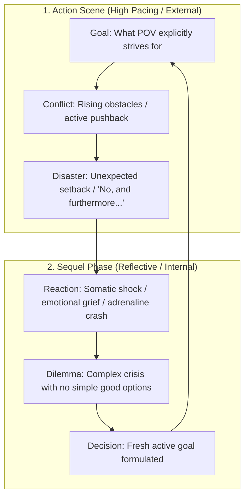

<!-- AI-GENERATED EDUCATIONAL NON-COMMERCIAL CREATIVE WORKFLOW TEMPLATE -->
# Scene Mechanics & Micro-Pacing Blueprint
### Mastering Dwight Swain's Scene & Sequel Architecture in Ars Arcanum

> [!NOTE] ⚠️ EDUCATIONAL TEMPLATE (AI-GENERATED)
> **Notice**: This template was AI-generated for educational demonstration and craft guidance within the Ars Arcanum operating system. It is strictly non-commercial and provided solely to demonstrate system features, mechanical schemas, and engine capabilities. Authors should replace placeholder values with their original scene designs.

💡 <b>Ars Arcanum Engine Guidance & Feature Breakdown (Click to Expand)</b>

### Features Demonstrated in This Blueprint:
- **MRU Sequence Validator**: `scene_mechanics` (`arcanum scene audit Manuscripts/Book-01`) — Audits Motivation-Reaction Units to ensure strict physiological order: External Stimulus $\to$ Involuntary Feeling / Reflex $\to$ Conscious Action $\to$ Dialogue.
- **Disaster Hook Classifier**: `scene_mechanics` (`arcanum scene audit Manuscripts/Book-01 --disasters`) — Categorizes scene endings into *Yes, but...* (temporary setback) vs *No, and furthermore...* (escalating crisis).
- **Sentence Length Waveform**: `pacing` (`arcanum pacing Manuscripts/Book-01`) — Visualizes paragraph-by-paragraph sentence length variation across tension spikes.
- **Prose Mode Classifier**: `pacing` (`arcanum pacing Manuscripts/Book-01 --modes`) — Evaluates ratio of Dialogue (fast) vs Action (medium) vs Exposition/Introspection (slow).
- **8-Channel Sensory Scanner**: `senses` (`arcanum senses Manuscripts/Book-01`) — Scans prose for Visual, Auditory, Olfactory, Gustatory, Tactile, Kinesthetic, Thermal, and Aetheric sensory grounding.
- **White Room Syndrome Sweeper**: `senses` (`arcanum senses Manuscripts/Book-01 --sweep-white-room`) — Identifies dialogue-heavy passages lacking physical environment anchors.

### How to Use for Your Projects:
1. When a chapter feels slow or meandering, audit whether it has an explicit **Goal** and ends on a visceral **Disaster**.
2. Avoid skipping the **Sequel** phase after high-intensity climaxes; characters must physically and psychologically react to trauma before forming a new goal.
3. Balance dialogue lines with physical action beats rather than repetitive dialogue tags (*"he said"*, *"she muttered"*).

---

## ⚙️ The Dual-Engine Cycle: Scene vs. Sequel

---

## 🔍 The 8-Channel Sensory Immersion Matrix

To ensure deep immersion, every chapter should ground the reader across multiple modalities from the 8 sensory channels:

| Sensory Channel | Somatic Prompt | Concrete In-World Prose Example |
| :--- | :--- | :--- |
| **1. Visual** | Light angle, contrasting textures, silhouettes, motion. | *"Silver moonlight sliced through the shattered leaded glass, illuminating floating dust motes above the pool of ink."* |
| **2. Auditory** | Background drone, sudden timbre changes, acoustic reverberation. | *"The hollow groan of iron hinges broke the rhythmic patter of rain against the cedar roof beams."* |
| **3. Olfactory** | Atmospheric scent markers, weather odors, chemical vapours. | *"The sharp bite of ozone and bitter pine resin overpowered the familiar mustiness of rotting vellum."* |
| **4. Gustatory** | Somatic mouthfeel, stress tastes, saliva viscosity. | *"The coppery tang of adrenaline coated the roof of his mouth as his teeth clamped down against the shock."* |
| **5. Tactile** | Surface textures, micro-textures, frictional drag. | *"The damp limestone balustrade sucked the heat from his palms through worn lambskin gloves."* |
| **6. Proprioceptive / Kinesthetic** | Acceleration, balance, vertigo, limb weight, inertia. | *"His center of gravity slipped on the rain-greased slate; gravity lurched sickeningly in his stomach as the parapet dropped away."* |
| **7. Thermal / Microclimate** | Temperature gradients, radiant heat, wind chill, humidity. | *"A wave of blistering aetheric heat radiated from the bronze conduit, scorching the fine hairs along his forearms."* |
| **8. Visceral / Interoceptive** | Heart rate spikes, diaphragmatic spasm, adrenaline surge, gut clench. | *"A sharp knot tightened beneath his sternum; his diaphragm seized as the high warning horn shook the stone floors."* |

---

## ✍️ Dialogue Craft: Action Beats over Tag Bloat

- ❌ **Avoid Dialogue Tag Bloat**:
  > *"We have to leave now," Kaelen said urgently. "They're at the gate," he added fearfully.*
- ✅ **Use Grounded Somatic Action Beats**:
  > *Kaelen slammed the heavy cedar folio shut and jammed the iron key into his belt.* *"We have thirty seconds before those hinges give way."*

---

## 📝 Collaborative Editorial Markup (CriticMarkup / Commentator)

Ars Arcanum integrates natively with the **Commentator** Obsidian plugin using standard CriticMarkup:

- **Addition**: `{++The silver focus flared with blinding intensity.++}`
- **Deletion**: `{--He felt slightly anxious about the storm.--}`
- **Substitution**: `{~~He looked at the door~>He kicked the oak timber inward~~}`
- **Highlight & Editorial Note**: `{==Kaelen held the seal==}{>>Check canon timeline: did he retrieve this before or after Chapter 2?<<}`
- **Inline Comment**: `{>>Ensure Motivation-Reaction Unit follows Stimulus -> Involuntary -> Action sequence.<<}`

<!-- ARS_ARCANUM_COMPREHENSIVE_CRAFT_AND_ENGINE_SHOWCASE -->

<strong>⚙️ Ars Arcanum Deterministic Engine &amp; Craft Doctrine Integration Guide (Click to Expand)</strong>

### How the CLI Compilers &amp; Craft Engines Use This Template
- **Unified VaultIndex (`arcanum vault-index`)**: Indexes YAML frontmatter (including `|` and `>` multiline block scalars), `@directives`, `[[Wikilinks]]`, multi-paragraph dialogue ratios, and SHA-256 paragraph hashes (`CACHE_VERSION = 3`).
- **Epistemic POV Firewall (`arcanum validate-epistemic`)**: Compares character `knows:` baselines against chapter `learns:` and `references:` (`EPI-201..203`).
- **Planetary Calendar &amp; Route Solver (`arcanum timeline-audit`)**: Audits `world.yaml` month lengths and `Locations/` route distances (`TIME-301..302`).
- **PolyGlot Conlang Linter (`arcanum conlang-check`)**: Validates lexicon terms and phonotactics (`CON-401..402`).
- **Resource Conservation Ledger (`arcanum ledger-audit`)**: Audits `resource_pools` and chapter `state_delta` transitions (`LED-501..502`).
- **Multi-POV Narrative Braid (`arcanum braid`)**: Tracks POV word shares, tension curves, and drought alerts (`BRD-601`).
- **Phase-Aware Effort (`arcanum sprint-effort`)**: Weights First Draft (`1.00x`), On-Phase Outline (`1.00x`), Worldbuilding (`0.50x`), Revision (`0.20x`), and blocks premature editing during Drafting (`0.00x`).
- **Live Obsidian Bridge (`arcanum continuity-suite`)**: Generates `_Arcanum_Diagnostics.md` inside your vault root.

