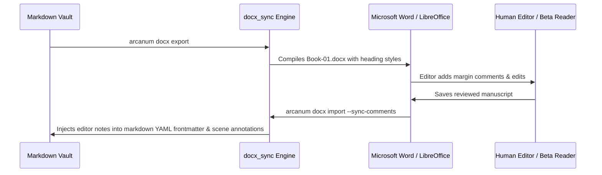

<!-- AI-GENERATED EDUCATIONAL NON-COMMERCIAL CREATIVE WORKFLOW TEMPLATE -->
# Typography, Punctuation Standards & DOCX Synchronization

> [!NOTE] ⚠️ EDUCATIONAL TEMPLATE (AI-GENERATED)
> **Notice**: This template was AI-generated for educational demonstration and craft guidance within the Ars Arcanum operating system. It is strictly non-commercial and provided solely to demonstrate system features, mechanical schemas, and engine capabilities. Authors should replace placeholder values with their original manuscript formatting rules.

💡 <b>Ars Arcanum Engine Guidance & Feature Breakdown (Click to Expand)</b>

### Features Demonstrated in This Guide:
- **Smart Quotes Normalizer**: `typography_cleaner` (`arcanum typography clean Manuscripts/Book-01`) — Converts straight quotes to typographic curly quotes (“”), double hyphens (`--`) to em-dashes (—), number ranges to en-dashes (–), and inserts non-breaking spaces before dialogue dashes.
- **Dialogue Comma Splice Linter**: `typography_cleaner` (`arcanum typography clean Manuscripts/Book-01 --check-splices`) — Audits dialogue punctuation inside quotes (*"Like this," she said.*) and eliminates orphan double spaces.
- **Bidirectional Markdown-DOCX Sync**: `docx_sync` (`arcanum docx sync Manuscripts/Book-01`) — Converts Markdown manuscripts into formatted Word documents for beta readers/editors and synchronizes tracked edits back into markdown.
- **Conflict Branching**: `docx_sync` (`arcanum docx build Manuscripts/Book-01`) — Creates safe side-by-side `.conflict.md` branch files when simultaneous markdown and DOCX modifications occur.

### How to Use for Your Projects:
1. Run `arcanum typography clean` before exporting print PDFs or sending review copies.
2. Use standardized scene break markers (`***` or `* * *`) centered between scene transitions.
3. Keep dialogue punctuation inside quotation marks (*"Like this," she said.*).

---

## 🔤 Typographic Invariants & Standards

| Element | Incorrect / Raw Plaintext | Typographically Polished (Ars Arcanum Standard) |
| :--- | :--- | :--- |
| **Smart Quotes** | `"Hello," he said.` / `'Never.'` | `“Hello,” he said.` / `‘Never.’` |
| **Em-Dashes (Dialogue Breaks)**| `I never--he stopped.` | `I never— he stopped.` (Non-breaking em-dash) |
| **En-Dashes (Number Ranges)** | `pages 10-15` / `1240-1248` | `pages 10–15` / `1240–1248` |
| **True Ellipses** | `Wait... what?` | `Wait… what?` (`U+2026`) |
| **Scene Break Divider** | `---` or `
` | `* * *` (Centered typographic asterism) |
| **Double Spaces** | `Sentence.  Next sentence.` | `Sentence. Next sentence.` (Single space standard) |

---

## 🔄 Bidirectional Word (.docx) Workflow

<!-- ARS_ARCANUM_COMPREHENSIVE_CRAFT_AND_ENGINE_SHOWCASE -->

<strong>⚙️ Ars Arcanum Deterministic Engine &amp; Craft Doctrine Integration Guide (Click to Expand)</strong>

### How the CLI Compilers &amp; Craft Engines Use This Template
- **Unified VaultIndex (`arcanum vault-index`)**: Indexes YAML frontmatter (including `|` and `>` multiline block scalars), `@directives`, `[[Wikilinks]]`, multi-paragraph dialogue ratios, and SHA-256 paragraph hashes (`CACHE_VERSION = 3`).
- **Epistemic POV Firewall (`arcanum validate-epistemic`)**: Compares character `knows:` baselines against chapter `learns:` and `references:` (`EPI-201..203`).
- **Planetary Calendar &amp; Route Solver (`arcanum timeline-audit`)**: Audits `world.yaml` month lengths and `Locations/` route distances (`TIME-301..302`).
- **PolyGlot Conlang Linter (`arcanum conlang-check`)**: Validates lexicon terms and phonotactics (`CON-401..402`).
- **Resource Conservation Ledger (`arcanum ledger-audit`)**: Audits `resource_pools` and chapter `state_delta` transitions (`LED-501..502`).
- **Multi-POV Narrative Braid (`arcanum braid`)**: Tracks POV word shares, tension curves, and drought alerts (`BRD-601`).
- **Phase-Aware Effort (`arcanum sprint-effort`)**: Weights First Draft (`1.00x`), On-Phase Outline (`1.00x`), Worldbuilding (`0.50x`), Revision (`0.20x`), and blocks premature editing during Drafting (`0.00x`).
- **Live Obsidian Bridge (`arcanum continuity-suite`)**: Generates `_Arcanum_Diagnostics.md` inside your vault root.

